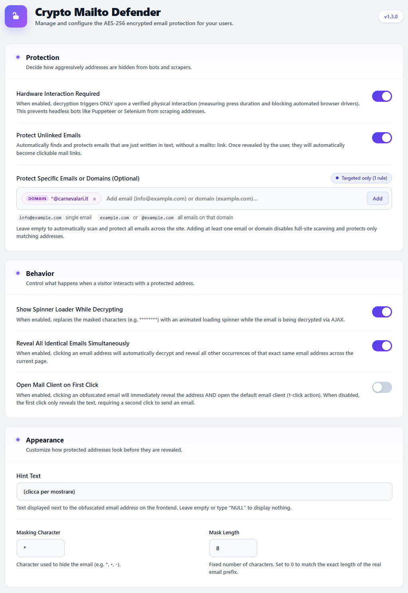

# 🛡️ Crypto Mailto Defender

**Enterprise-grade email spam protection for WordPress.** Encrypts `mailto:` links and plain-text emails server-side with **AES-256-GCM** and unlocks them only for verified humans.

Standard obfuscation tricks—ROT13, CSS direction, HTML entities, or Base64/XOR—are easily bypassed by modern scrapers, AI crawlers, and headless browsers. **Crypto Mailto Defender** ensures your email addresses never appear in the HTML source or DOM until a real user interacts with them.

---

## ⚡ How It Works

1. **Global or Targeted Interception:** Captures final output early on `init` (HTML, JSON, AJAX/REST), matching every `mailto:` link and plain-text email—or only the specific addresses and wildcard domains you configure.
2. **AES-256-GCM Encryption:** Encrypts each address with a unique 256-bit key, 96-bit IV, and 128-bit authentication tag bound to your site's `home` URL, replacing it in the HTML with a customizable mask (e.g., `********@domain.com`).
3. **Human Proof & AJAX Decryption:** On click or tap, the frontend validates physical interaction telemetry (press timing, pointer geometry, hardware score, and a SHA-256 Proof-of-Work) and decrypts the address via **server-side AJAX**. The secret key never leaves your server.

---

## ✨ Key Features

- 🎯 **Global or Targeted Protection:** Protect all emails site-wide, or restrict encryption to specific addresses (`info@example.com`) and wildcard domains (`*@example.com`), bypassing full-site regex scanning.
- 🚀 **0ms Early-Exit Engine:** Responses without `@` (or without configured target rules) skip PCRE scanning completely; frontend JS loads non-blockingly via `defer`.
- 🤖 **Anti-Headless Bot Shield:** Blocks Puppeteer, Playwright, Selenium, WebDriver, cURL, and Python scrapers via press timing, pointer telemetry, WebGL software-renderer checks, `isTrusted` events, and Same-Origin/Client-Hints validation.
- ⚡ **100% Cache-Friendly:** Uses deterministic HMAC tokens instead of expiring WordPress nonces—works seamlessly with **Cloudflare, WP Rocket, LiteSpeed Cache, and W3 Total Cache**.
- 🌐 **Page Builder Compatible:** Works across posts, headers, footers, widgets, and builders (**Elementor, Divi, Bricks, Oxygen, Beaver Builder, WPBakery, Breakdance, Gutenberg**).
- 📋 **1-Step or 2-Step UX:** Reveal text links on the first click and open the mail client on the second, or launch `mailto:` immediately.
- 🛡️ **Built-In Rate Limiting & Anti-Replay:** Protects `admin-ajax.php` with a 500-entry bucket, 300s TTL anti-replay checks, 3x failed-attempt penalties, and Object Cache support.
- ♿ **Accessible by Design:** Full keyboard navigation (`Tab` + `Enter` / `Space`), `aria-live="polite"` announcements, `prefers-reduced-motion` support, and screen-reader friendly markup.

---

## 📸 Admin Interface

---

## 🔧 Developer Hooks

Customize behavior via standard WordPress filters:

| Filter | Description |
| :--- | :--- |
| `cryptomail_skip_request` | Return `true` to bypass email protection on custom routes, builders, or previews. |
| `cryptomail_client_ip` | Override client IP detection when running behind Cloudflare or a reverse proxy. |
| `cryptomail_rate_limit` | Customize the maximum decryption requests allowed per minute per IP. |

---

## 📦 Installation & Changelog

* **Install from WordPress.org:** Search for **Crypto Mailto Defender** under **Plugins > Add New** in your WordPress dashboard, or download the latest release `.zip` from the [Releases](../../releases) page.
* **Version History:** See [CHANGELOG.md](CHANGELOG.md) for the full release history.

---

## 💖 Support & Acknowledgements

**Crypto Mailto Defender** is 100% free and open-source with no paid "Pro" tier. If it helps keep spam out of your inbox, consider [buying me a coffee via PayPal](https://www.paypal.me/marco00petrucci).

Inspired by Spencer Mortensen's article [Email Obfuscation](https://spencermortensen.com/articles/email-obfuscation/).